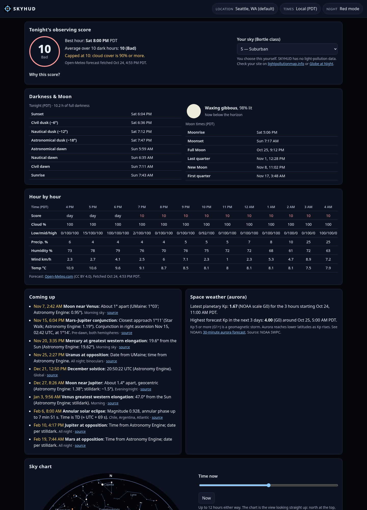

# SKYHUD

A night-sky dashboard for stargazers. It answers one question: **is tonight worth going out, and what's up there?**
It is a static site that runs entirely in your browser. There's no backend, no account, no API keys, no analytics, no web fonts and no third-party scripts.

**Live:** https://galacticlight.github.io/SKYHUD/



## Features

- **Observing score (0–100)** for each dark hour tonight. It shows the best hour, the night average and a "Why this score?" table listing every input and weight.
- **Darkness & Moon**: sunset, civil, nautical and astronomical twilight, sunrise, and hours of full darkness. Moon phase drawing, illumination, moonrise and moonset, and the next four phases. Polar day and night are handled: "Sun doesn't rise" or "no astronomical night". A **darkness timeline** bar runs from local midday to midday, shaded by Sun altitude (daylight, civil, nautical, astronomical twilight, full darkness), built from the same exact crossings as the twilight table and checked minute by minute against the Sun's altitude, so near the poles a short extra sunset or dusk before the next midday gets its own band. Within 5 minutes of a table crossing, a minute that only disagrees by showing the neighbouring band is not split off: there the table (refracted upper limb, exact semidiameter) and the plain −0.833°/−6°/−12°/−18° altitude thresholds differ by seconds, or by up to about 2 minutes where the Sun grazes a threshold, so the bar keeps the table's crossing time. Everywhere else the bar follows the Sun's altitude, including the first minutes after midday, and the spoken label skips any band shorter than a minute. If the crossings can't be chained it falls back to 1-minute sampling and says "approximate", with a strip for when the Moon is up and a "now" marker that moves once a minute. It is computed on your device; the twilight table beside it is its text equivalent.
- **Hour-by-hour table**: low, mid and high cloud, precipitation chance, humidity, wind and temperature, with the score for each dark hour.
- **Live sky dome**: a polar altitude/azimuth view (stereographic, zenith in the centre) with 1,600+ stars to magnitude 5, constellation lines and names, the ecliptic, the Sun, a Moon drawn at its current phase, the planets and live satellites. It redraws every second at "now", and a slider scrubs ±24 hours. Active meteor-shower radiants carry a badge with the shower, ZHR and live altitude, drawn faint with a dashed badge when a more-than-half-lit Moon is up. A "Next" line counts down to the next sunset, darkness, moonrise/set, visible ISS pass or listed event, each tagged with where it comes from. The text list under the dome is the table equivalent.
  - A time slider covers ±12 h in 15-minute steps.
  - Pointer tooltips name what you're pointing at.
  - An accessible text list shows what's above the horizon.
- **Planets**: magnitude, current altitude and direction, rise and set times, and distance from the Sun.
- **Earth map: ISS**: a world map (plate carrée, Natural Earth coastlines, no tiles) with the ISS live position from wheretheiss.at, polled every 10 seconds only while the map is on screen (once a minute with reduced motion), and its ground track for the last 45 and next 95 minutes, computed on your device with SGP4 from CelesTrak elements. Everything is labelled approximate. If the live feed is down or more than 60 seconds old, the dot switches to the computed position and the card says so. A table of the track is the text equivalent. Your location is drawn as a cross locally and is never sent.
- **Aurora oval**: NOAA SWPC's OVATION 30–90 minute aurora forecast drawn as a glow on the same map (fetched every 10 minutes only while the map is on screen; about 140 KB gzipped), with the probability at your location, the forecast and observation times, and a table of the oval's edge by longitude. A compact copy is saved for offline use and labelled as a saved copy.
- **Cloud layers strip**: the next 48 hours of low, mid and high cloud from the Open-Meteo forecast, drawn over each hour's darkness (daylight to full darkness), with a count of mostly-clear dark hours and a table.
- **Space weather panel**: planetary Kp as bars (3 days observed, 3 days NOAA forecast) with a 0–9 gauge; GOES X-ray flux on a log chart with A/B/C/M/X flare bands; and the last 2 hours of solar wind speed, density and magnetic field (Bt, Bz) from the spacecraft NOAA marks active. Each panel shows its source, newest reading time, a stale or saved-copy warning, and a table. The large solar-wind files (about 95 KB gzipped for plasma and 141 KB for magnetic field) load only when the panel is on screen, at most every 15 minutes.
- **ISS & bright satellites**: 24-hour pass predictions (SGP4 in a Web Worker) from CelesTrak elements, with a bundled fallback.
  - The element age is shown, with a warning if it's over 7 days.
  - The ISS's live position comes from wheretheiss.at.
- **Rocket launches**: the next 5 launches worldwide (provider, vehicle, pad, time in your time zone) from RocketLaunch.Live, with a table.
- **Launch tracker**: every orbital launch attempt of the year (UTC) from Launch Library 2, with a tally (success, failure, partial failure, awaiting outcome), the date range it covers, a per-provider breakdown (chart plus table), a year selector for archived years, and a filterable list showing each launch's provider and country, vehicle, pad, mission type and orbit, payloads from LL2's payload records ("Not in LL2 payload records" when LL2 has none, which says nothing about secrecy) and failure reasons. The browser reads only a same-origin snapshot, `data/launches.json`, which a GitHub Action refreshes about every 2 hours. The card shows the snapshot time and labels a stale, incomplete or unreadable snapshot instead of showing zeros.
- **Deep Space Network now (unofficial)**: which spacecraft each DSN dish at Goldstone, Madrid and Canberra is talking to, with signal direction, band, data rate and round-trip light time, plus a table. It reads NASA/JPL's undocumented DSN Now feed, so it is labelled unofficial.
- **Space weather**: NOAA SWPC planetary Kp (latest and the 3-day maximum forecast) with the G-scale.
- **Golden & blue hour**: evening and morning golden hour (Sun +6° to −4°) and blue hour (−4° to −6°), computed on your device, with the thresholds stated.
- **Moon distance & libration**: the Moon's distance and apparent size now, the next perigee and apogee, and the current libration in longitude and latitude, computed on your device.
- **Computed sky events**: under Coming up, the next 12 months of equinoxes and solstices, lunar eclipses (with the Moon's altitude here at mid-eclipse), solar eclipses visible from your location, Mercury and Venus greatest elongations and planet oppositions, all computed on your device.
- **Save as image**: a PNG of the dome with the time, tonight's best window and score, the Moon and the data sources, made and saved on your device (nothing uploaded). The place name is included only if you tick the box.
- **NOAA scales, alerts & flare odds**: the current R/S/G levels (glyph + word), the previous UTC day's highest, NOAA's 3-day outlook, C/M/X flare and proton-event odds, and the last 48 hours of NOAA alerts, watches and warnings (full text in a disclosure). Shown exactly as NOAA publishes them, each with its own source and time line.
- **Meteor showers**: the IMO 2026 calendar. Peaks are worked out from solar longitude and labeled approximate, alongside the Moon's illumination at each peak and the radiant's highest altitude for your location.
- **Coming up**: a hand-checked event list (conjunctions, oppositions, eclipses). Each event links its source.
- **Location**: device geolocation (only when you press the button), Open-Meteo place search, or typed latitude and longitude. It's saved in `localStorage` only, rounded to 0.01°, and **Forget my location** in the location dialog deletes it and the cached forecast.
- **Bortle class picker** for your light pollution, with links to lightpollutionmap.info and Globe at Night.
- **Red night-vision mode**: a dedicated all-red theme with a brightness slider, not a CSS filter. Opt-in. Text keeps a brightness floor so contrast stays at or above 4.5:1 (about 4.9:1 at the dimmest setting); muted text uses the same red. The **R** shortcut can be switched off in the footer and is ignored on key repeat, with modifier keys, and while a button, link or text field has focus.
- **Local time or UTC** toggle. Works offline after the first visit (service worker), with clear "unavailable" messages instead of made-up numbers.
- Accessibility: keyboard reachable, 44 px touch targets, reduced-motion support, works from 390 px wide.

### Live updates, motion and pausing

All moving parts share one `requestAnimationFrame` loop (`js/live.js`). It sleeps between due times, stops completely while the tab is hidden, and runs each card's task only while that card is on or near the screen (IntersectionObserver). **Pause live updates** (bottom-right, always on screen) stops every redraw and feed poll until pressed again. With `prefers-reduced-motion`, 1-second redraws and countdown seconds drop to once a minute and nothing animates. Nothing flashes.

## Run it

```bash
python3 -m http.server 8000   # then open http://localhost:8000/
npm test                      # node --test tests/*.test.mjs: accuracy, data, workflow and site tests (Node ≥ 18, no dependencies)
```

### Deploying (GitHub Pages)
**Action needed by the repository owner (one time):** open **Settings > Pages > Build and deployment** and set **Source** to **GitHub Actions**. Only an owner/admin can change this, and until it's done the launch tracker's data commits never reach the live site.

Why: the launch-data workflow pushes with `GITHUB_TOKEN`, and GitHub does not start a Pages build for those pushes. So `.github/workflows/pages.yml` deploys the site as an Actions artifact: on every push to `main`, on manual dispatch, and when `launches.yml` calls it right after a data commit. The artifact holds only the site's own files (`scripts/build-site.mjs`: HTML, CSS, `js/`, `vendor/`, `data/`, `icons/`, the service worker, manifest, favicon, `catalog.tle` and `LICENSE`), byte for byte as the branch deploy serves them; tests, scripts, workflows, docs and package files are left out (`tests/site.test.mjs` checks the list).

Until the switch: Pages keeps serving the repo root from `main` (`.nojekyll`) as before. `pages.yml` first reads the Pages source and skips its deploy (with a notice) while the source is still the branch, so landing it changes nothing; data commits then go live with the next human push. After the switch the branch deploy stops and `pages.yml` does every deploy.

## Methods

### Astronomy (computed locally)
[Astronomy Engine](https://github.com/cosinekitty/astronomy) 2.1.19 (MIT, Don Cross) is vendored in `vendor/`. It computes:
- Sun, Moon and planet positions (topocentric, with refraction)
- rise, set and twilight times, and Moon phases
- the J2000 solar longitude used for meteor peaks

Stars (J2000) are rotated to the horizon with the engine's `Rotation_EQJ_HOR`, which includes precession and nutation. Rise and set assume a flat sea-level horizon.

**Accuracy is checked by `tests/astro.test.mjs`:**

| Check | Reference | Result |
|---|---|---|
| Alt/az of Sun, Moon, 7 planets (Seattle, Sydney, London; 2 times each) | JPL Horizons (airless) | worst 0.36′ (Venus); Sun 0.03′, Moon 0.08′ |
| Rise/set (11 events) | JPL Horizons | within the reference's 1-min step |
| SF Dec 21 2026 sunrise/sunset/twilight; SF Moon rise/set Dec 14 | timeanddate.com | ±1 min |
| Tromsø Dec 21 2026 | timeanddate.com | "Sun never rises" + civil/nautical/astronomical twilight ±1 min |
| Moon phases (Oct–Dec 2026) | JPL Horizons (geocentric apparent longitudes, instants to the second) | ±45 s, compared unrounded; measured +27 to +40 s late on all 13 phases |
| Meteor-shower peaks (Taurids, Leonids, Geminids, Ursids, Quadrantids 2026/27) | IMO calendar | ±1 day (all within 7.1 h) |
| Moon illumination | Horizons / timeanddate | within 1 percentage point (sources differ: topocentric or geocentric) |
| IMO shower maxima from λ☉ | IMO 2026 calendar | within the IMO date |

### Satellites
SGP4 ([satellite.js](https://github.com/shashwatak/satellite-js) 5, MIT) runs on CelesTrak "visual" elements, checked every 30 s over 24 h.
- A pass counts if its highest point is ≥10°.
- It's *visible* when the satellite is sunlit (cylindrical Earth shadow) while your Sun is below −6°.
- Brightness isn't predicted.
- Accuracy depends on how old the elements are; SKYHUD shows the element age and doesn't claim a specific error.

### Observing score: "SKYHUD heuristic v1"
This formula is **our own design, not a published standard**:

```
score = 100 × (0.45·clouds + 0.20·moon + 0.15·darkness + 0.10·lightPollution + 0.05·transparency + 0.05·windDew)
clouds        = 1 − min(1, (low + 0.8·mid + 0.5·high) / 100)
moon          = 1 if Moon below horizon, else 1 − illum·(0.5 + 0.5·sin(alt))
darkness      = 1 (Sun < −18°), 0.6 (< −12°), 0.2 (< −6°), 0 otherwise
lightPollution= (9 − Bortle) / 8          (Bortle chosen by you; default 5)
transparency  = 0.5·min(1, visibility/30 km) + 0.5·(1 − max(0, RH − 60)/40)
windDew       = 0.5·(1 − min(1, wind/40 km/h)) + 0.5·min(1, (T − Td)/5 °C)
total cloud ≥ 90 %  →  score capped at 10
bands: 80+ Excellent · 60–79 Good · 40–59 Fair · 20–39 Poor · <20 Bad
```
If any weather input is missing, no score is shown. It doesn't forecast astronomical seeing.

### Meteor showers and events
Shower data comes from the [IMO 2026 Meteor Shower Calendar](https://www.imo.net/files/meteor-shower/cal2026.pdf): activity windows, λ☉ of maximum, radiant and ZHR. Peaks are labeled **approximate (±1 day)**. Activity windows are calendar dates shown in UTC.

`data/events.json` was compiled on 2026-10-24 from the sources linked for each item. Two kinds of item are left out on purpose:
- items that couldn't be verified, such as the Nov 2 2026 Moon–Jupiter occultation and the Venus–Spica pairing
- Moon phases and meteor peaks, which are computed live

Eclipse times are shown in UTC/local time: NASA lists them in TD, and we subtract 69 s (TT − UTC = 32.184 s + 37 leap seconds = 69.184 s, assuming no new leap second).

## Data sources & terms

| Data | Source | Terms |
|---|---|---|
| Hourly forecast | [Open-Meteo](https://open-meteo.com/) | CC BY 4.0; free tier is **non-commercial**. Open-Meteo keeps request logs for up to 90 days |
| Place search | Open-Meteo geocoding | Location data based on [GeoNames](https://www.geonames.org/) (CC BY 4.0) |
| Kp index, Kp forecast, GOES X-ray, real-time solar wind, OVATION aurora, space weather scales, alerts, flare probabilities | [NOAA SWPC](https://www.swpc.noaa.gov/) | US government data, credited; reuse terms not separately verified; no endorsement implied |
| Orbital elements | [CelesTrak](https://celestrak.org/) | Cached 6 h per browser; after a failed download, the saved copy (or bundled `catalog.tle`) is used and CelesTrak is not asked again for an hour |
| ISS live position | [wheretheiss.at](https://wheretheiss.at/) | Free public API (about 1 request/s allowed; SKYHUD polls every 10 s while the map is visible) |
| Rocket launches (next 5 worldwide) | Data by [RocketLaunch.Live](https://www.rocketlaunch.live/) free feed `fdo.rocketlaunch.live/json/launches/next/5` | Free feed, credited in the card as "Data by RocketLaunch.Live". Fetched at most every 15 min (saved copy reused in between), only while the card is on screen; fixed URL, no location sent; text fields only (no media) |
| Launch tracker (orbital launches of the year) | Launch Library 2 by [The Space Devs](https://thespacedevs.com/), API v2.3.0 (`ll.thespacedevs.com/2.3.0/launches/`), saved as `data/launches.json` by `.github/workflows/launches.yml` | Credited in the card as "Launch data: Launch Library 2 by The Space Devs (thespacedevs.com)". The free tier allows 15 requests per hour per IP; the Action makes about 5 per run (about 9 when it meets a new provider and refreshes the country list) and runs every 2 hours, so the browser never calls LL2 and no new CSP origin is needed. Text fields only (no LL2 images). Counts can differ from other tallies (e.g. Wikipedia/GCAT count some Starship test flights as orbital; LL2 marks them suborbital, so they are not counted here) |
| Deep Space Network now (**unofficial**) | NASA/JPL [DSN Now](https://eyes.nasa.gov/dsn/dsn.html) feed `eyes.nasa.gov/dsn/data/dsn.xml`; spacecraft names from DSN Now's `config.xml`, bundled as `data/dsn-spacecraft.json` | Undocumented feed behind NASA/JPL's DSN Now page: labelled unofficial in the card and may change or stop without notice; credited "NASA/JPL DSN Now". Fetched at most once a minute and only while the card is on screen and the tab is visible; fixed URL, no location sent. The server allows caching for an hour (`max-age=3600`), so SKYHUD revalidates each request and labels data whose own timestamp is over 5 minutes old as stale. A feed that fails to parse or has changed shape shows "Unavailable", never "no spacecraft" |
| Coastlines | [Natural Earth](https://www.naturalearthdata.com/) 1:110m, `data/coast110.json` rounded to 0.1° | Public domain |
| Meteor showers | [International Meteor Organization](https://www.imo.net/) | Cited |
| Eclipses | Eclipse Predictions by Fred Espenak, [NASA GSFC](https://eclipse.gsfc.nasa.gov/) | Cited |
| Star catalog & constellation lines | [d3-celestial](https://github.com/ofrohn/d3-celestial) (Olaf Frohn; Hipparcos/HYG) | BSD-3-Clause |
| Astronomy | Astronomy Engine 2.1.19 | MIT |
| SGP4 | satellite.js 5 | MIT |

The Content-Security-Policy `connect-src` allows only these origins:
- `api.open-meteo.com`
- `geocoding-api.open-meteo.com`
- `services.swpc.noaa.gov`
- `api.wheretheiss.at`
- `celestrak.org`
- `fdo.rocketlaunch.live` (rocket launches)
- `eyes.nasa.gov` (Deep Space Network now; one fixed path)

Requests outside the CSP: `fdo.rocketlaunch.live` sits behind Cloudflare, whose responses carry `Report-To`/`NEL` headers. Chrome may therefore send network-error reports (failed or slow requests to that host, not page content or location) to `a.nel.cloudflare.com`. These are sent by the browser itself, so `connect-src` does not apply and SKYHUD can't turn them off; they stop if you never open the launches card or if your browser disables NEL/Reporting.

### Launch data updates (GitHub Action)
`.github/workflows/launches.yml` runs `scripts/update-launches.mjs` every 2 hours (cron `17 */2 * * *`) and on manual dispatch, checks the result with `tests/launchdata.test.mjs`, and commits `data/launches.json` only when it changed or is over 6 hours old. On the first run of a new UTC year it saves the finished year as `data/launches-<year>.json`. The script refuses to write a snapshot when a page is missing, the API's own count doesn't add up, rows fail to parse (feed drift), a response is over 5 MB (read as a stream and cut off at the cap), or the count drops by more than 5%, so a bad run leaves the last good snapshot in place, and the card's "Stale" label shows once it is over 12 hours old. Caveats:
- GitHub runs scheduled workflows on a best-effort basis: runs can start late or be dropped when Actions is busy, especially at the top of the hour (hence minute 17).
- GitHub disables scheduled workflows in a public repository after 60 days with no repository activity. The workflow's last job, `keep-enabled` (the only job with `actions: write`), calls `gh api -X PUT repos/<owner>/<repo>/actions/workflows/launches.yml/enable` on every run, even a failed one, so a schedule that keeps running keeps itself enabled (and its data commits are repository activity too). GitHub doesn't document whether this call restarts the 60-day clock. If the schedule has already been disabled, no run happens to re-enable it: turn it back on from the Actions tab (Update launch data > Enable workflow) or with a manual dispatch.
- On HTTP 429 (rate limited) or 5xx the script waits (honouring `Retry-After`, up to 5 min, otherwise 60 s) and retries once, then gives up for that run without writing anything.
- Bot commits land on `main`, so pull before pushing local work. The bot's own push is fast-forward only (`git push origin HEAD:main`; no pull, rebase or force): if `main` moved during the run, the push is rejected, the run fails, and the next run starts from a fresh checkout.
- Main only: the `update` job runs only when `github.ref` is `refs/heads/main`, so a manual run started from another branch can't push that branch to `main`; `pages.yml` has the same guard (its `check` job, which `build` and `deploy` need), so it deploys only from `main` (on a push, a manual run, or the call from `launches.yml`, where `github.ref` is the caller's).
- Checkout doesn't keep the token (`persist-credentials: false`), so the fetch script and tests run without it. Only the push step gets it, as a header for that one git command, and only the `update` job has `contents: write`.
- After a data commit the workflow's `deploy` job calls `pages.yml` to publish it (see Deploying above). `pages.yml` runs one at a time (workflow-level concurrency group `pages-site`, `cancel-in-progress: false`) and its build checks out the current tip of `main`, not the commit that started the run, so deploys never go backwards: a slow bot run can't put an older data commit back over a newer human push. A deploy that has started is never cancelled; a run still waiting is replaced by a newer one (shown as cancelled), which builds the newer `main` anyway.
- Run it locally with `node scripts/update-launches.mjs --out data` (Node 22, no dependencies).

## Privacy
Your location is stored in your browser's `localStorage`. It's sent only to Open-Meteo, rounded to 0.01° (about 1 km), to get the forecast. A place search sends only the text you type. No other request includes your location: the launch feed (RocketLaunch.Live, `fdo.rocketlaunch.live`) and the DSN feed (NASA/JPL DSN Now, `eyes.nasa.gov`) are fixed URLs, though like any web request they see your IP address and this site's address; the launch tracker reads a Launch Library 2 copy stored on this site, so the browser never contacts Launch Library 2. The lightpollutionmap.info link in the score card carries the same rounded coordinates, and they leave the browser only if you click it. Otherwise your location stays in this browser. There are no cookies, analytics or trackers.

## Project layout
```
index.html  styles.css  404.html  sw.js  manifest.webmanifest
js/boot.js (loads app.js; one guarded reload if a half-finished update breaks it)  js/app.js (UI)  js/space.js  js/launches.js  js/tracker.js  js/launchdata.js  js/dsn.js  js/astro.js (engine wrapper)  js/chart.js  js/score.js  js/showers.js  js/feeds.js  js/sat-worker.js
vendor/astronomy.browser.min.js  vendor/satellite.min.js
data/sky.json  data/events.json  data/dsn-spacecraft.json  data/launches.json (written by the Action)  catalog.tle
scripts/update-launches.mjs  scripts/launch-providers.json  scripts/build-site.mjs
.github/workflows/launches.yml (data)  .github/workflows/pages.yml (deploy)
tests/*.test.mjs  tests/_xml.mjs  tests/fixtures/ (horizons.json, rll-next5.json, dsn.xml, launches-snapshot.json, ll2-previous-page.json)  tests/gen_fixtures.py
```

## Credits & license
SKYHUD © galacticlight, [MIT](LICENSE). It bundles Astronomy Engine (MIT, Don Cross), satellite.js (MIT) and d3-celestial data (BSD-3-Clause, Olaf Frohn; full notice in [data/LICENSE-d3-celestial.txt](data/LICENSE-d3-celestial.txt)). Not for navigation or safety-critical use.

### Design inspiration (ideas only)
These sites inspired features. No assets, code, imagery, text, logos or branding were copied, and SKYHUD makes no requests to them.

| Feature | Commit | Inspired by |
|---|---|---|
| Dome label placement and decluttering | 9df2a20 | Stellarium Web |
| Tonight at a glance strip | c717178 | Sky & Telescope, Time and Date, Clear Outside |
| Hourly Good/OK/Poor row, dew-point spread, visibility | 82678eb | Clear Outside |
| "Tonight" planner advice for the Moon and planets | 3d96e61 | Time and Date, Star Walk, TheSkyLive |
| NOAA scales, alerts and flare odds | 466ccce | NOAA SWPC, SpaceWeatherLive |
| Moon distance, perigee/apogee, libration | cb155fa | TheSkyLive, Time and Date |
| Golden and blue hour | 505ce12 | Time and Date, Clear Outside |
| Computed eclipses, elongations, oppositions, seasons | e0cd6d3 | Sky & Telescope, TheSkyLive, Time and Date |
| PNG share card | 2fa7d7e | Star Walk, Sky & Telescope |
