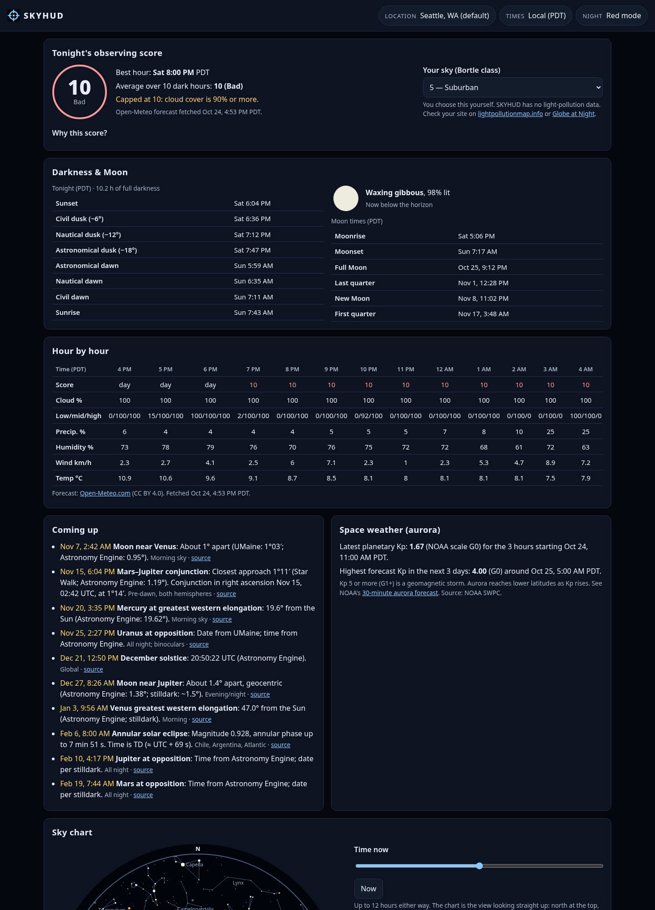

# SKYHUD

A night-sky dashboard for stargazers. It answers one question: **is tonight worth going out, and what's up there?**
It is a static site that runs entirely in your browser. There's no backend, no account, no API keys, no analytics, no web fonts and no third-party scripts.

**Live:** https://galacticlight.github.io/SKYHUD/



## Features

- **Observing score (0–100)** for each dark hour tonight. It shows the best hour, the night average and a "Why this score?" table listing every input and weight.
- **Darkness & Moon**: sunset, civil, nautical and astronomical twilight, sunrise, and hours of full darkness. Moon phase drawing, illumination, moonrise and moonset, and the next four phases. Polar day and night are handled: "Sun doesn't rise" or "no astronomical night". A **darkness timeline** bar runs from local midday to midday, shaded by Sun altitude (daylight, civil, nautical, astronomical twilight, full darkness, sampled every 10 minutes), with a strip for when the Moon is up and a "now" marker that moves once a minute. It is computed on your device; the twilight table beside it is its text equivalent.
- **Hour-by-hour table**: low, mid and high cloud, precipitation chance, humidity, wind and temperature, with the score for each dark hour.
- **Live sky dome**: a polar altitude/azimuth view (stereographic, zenith in the centre) with 1,600+ stars to magnitude 5, constellation lines and names, the ecliptic, the Sun, a Moon drawn at its current phase, the planets and live satellites. It redraws every second at "now", and a slider scrubs ±24 hours. Active meteor-shower radiants carry a badge with the shower, ZHR and live altitude, drawn faint with a dashed badge when a more-than-half-lit Moon is up. A "Next" line counts down to the next sunset, darkness, moonrise/set, visible ISS pass or listed event, each tagged with where it comes from. The text list under the dome is the table equivalent.
  - A time slider covers ±12 h in 15-minute steps.
  - Pointer tooltips name what you're pointing at.
  - An accessible text list shows what's above the horizon.
- **Planets**: magnitude, current altitude and direction, rise and set times, and distance from the Sun.
- **Earth map: ISS**: a world map (plate carrée, Natural Earth coastlines, no tiles) with the ISS live position from wheretheiss.at, polled every 10 seconds only while the map is on screen (once a minute with reduced motion), and its ground track for the last 45 and next 95 minutes, computed on your device with SGP4 from CelesTrak elements. Everything is labelled approximate. If the live feed is down or more than 60 seconds old, the dot switches to the computed position and the card says so. A table of the track is the text equivalent. Your location is drawn as a cross locally and is never sent.
- **ISS & bright satellites**: 24-hour pass predictions (SGP4 in a Web Worker) from CelesTrak elements, with a bundled fallback.
  - The element age is shown, with a warning if it's over 7 days.
  - The ISS's live position comes from wheretheiss.at.
- **Space weather**: NOAA SWPC planetary Kp (latest and the 3-day maximum forecast) with the G-scale.
- **Meteor showers**: the IMO 2026 calendar. Peaks are worked out from solar longitude and labeled approximate, alongside the Moon's illumination at each peak and the radiant's highest altitude for your location.
- **Coming up**: a hand-checked event list (conjunctions, oppositions, eclipses). Each event links its source.
- **Location**: device geolocation (only when you press the button), Open-Meteo place search, or typed latitude and longitude. It's saved in `localStorage` only, rounded to 0.01°, and **Forget my location** in the location dialog deletes it and the cached forecast.
- **Bortle class picker** for your light pollution, with links to lightpollutionmap.info and Globe at Night.
- **Red night-vision mode**: a dedicated all-red theme with a brightness slider, not a CSS filter. Opt-in. Text keeps a brightness floor so contrast stays at or above 4.5:1 (about 4.9:1 at the dimmest setting); muted text uses the same red. The **R** shortcut can be switched off in the footer and is ignored on key repeat, with modifier keys, and while a button, link or text field has focus.
- **Local time or UTC** toggle. Works offline after the first visit (service worker), with clear "unavailable" messages instead of made-up numbers.
- Accessibility: keyboard reachable, 44 px touch targets, reduced-motion support, works from 390 px wide.

### Live updates, motion and pausing

All moving parts share one `requestAnimationFrame` loop (`js/live.js`). It sleeps between due times, stops completely while the tab is hidden, and runs each card's task only while that card is on or near the screen (IntersectionObserver). **Pause live updates** (bottom-right, always on screen) stops every redraw and feed poll until pressed again. With `prefers-reduced-motion`, 1-second redraws and countdown seconds drop to once a minute and nothing animates. Nothing flashes.

## Run it

```bash
python3 -m http.server 8000   # then open http://localhost:8000/
npm test                      # 23 accuracy & data tests (Node ≥ 18, no dependencies)
```

GitHub Pages serves the repo root from `main` (`.nojekyll`).

## Methods

### Astronomy (computed locally)
[Astronomy Engine](https://github.com/cosinekitty/astronomy) 2.1.19 (MIT, Don Cross) is vendored in `vendor/`. It computes:
- Sun, Moon and planet positions (topocentric, with refraction)
- rise, set and twilight times, and Moon phases
- the J2000 solar longitude used for meteor peaks

Stars (J2000) are rotated to the horizon with the engine's `Rotation_EQJ_HOR`, which includes precession and nutation. Rise and set assume a flat sea-level horizon.

**Accuracy is checked by `tests/astro.test.mjs`:**

| Check | Reference | Result |
|---|---|---|
| Alt/az of Sun, Moon, 7 planets (Seattle, Sydney, London; 2 times each) | JPL Horizons (airless) | worst 0.36′ (Venus); Sun 0.03′, Moon 0.08′ |
| Rise/set (11 events) | JPL Horizons | within the reference's 1-min step |
| SF Dec 21 2026 sunrise/sunset/twilight; SF Moon rise/set Dec 14 | timeanddate.com | ±1 min |
| Tromsø Dec 21 2026 | timeanddate.com | "Sun never rises" + civil/nautical/astronomical twilight ±1 min |
| Moon phases (Oct–Dec 2026) | JPL Horizons (geocentric apparent longitudes, instants to the second) | ±45 s, compared unrounded; measured +27 to +40 s late on all 13 phases |
| Meteor-shower peaks (Taurids, Leonids, Geminids, Ursids, Quadrantids 2026/27) | IMO calendar | ±1 day (all within 7.1 h) |
| Moon illumination | Horizons / timeanddate | within 1 percentage point (sources differ: topocentric or geocentric) |
| IMO shower maxima from λ☉ | IMO 2026 calendar | within the IMO date |

### Satellites
SGP4 ([satellite.js](https://github.com/shashwatak/satellite-js) 5, MIT) runs on CelesTrak "visual" elements, checked every 30 s over 24 h.
- A pass counts if its highest point is ≥10°.
- It's *visible* when the satellite is sunlit (cylindrical Earth shadow) while your Sun is below −6°.
- Brightness isn't predicted.
- Accuracy depends on how old the elements are; SKYHUD shows the element age and doesn't claim a specific error.

### Observing score: "SKYHUD heuristic v1"
This formula is **our own design, not a published standard**:

```
score = 100 × (0.45·clouds + 0.20·moon + 0.15·darkness + 0.10·lightPollution + 0.05·transparency + 0.05·windDew)
clouds        = 1 − min(1, (low + 0.8·mid + 0.5·high) / 100)
moon          = 1 if Moon below horizon, else 1 − illum·(0.5 + 0.5·sin(alt))
darkness      = 1 (Sun < −18°), 0.6 (< −12°), 0.2 (< −6°), 0 otherwise
lightPollution= (9 − Bortle) / 8          (Bortle chosen by you; default 5)
transparency  = 0.5·min(1, visibility/30 km) + 0.5·(1 − max(0, RH − 60)/40)
windDew       = 0.5·(1 − min(1, wind/40 km/h)) + 0.5·min(1, (T − Td)/5 °C)
total cloud ≥ 90 %  →  score capped at 10
bands: 80+ Excellent · 60–79 Good · 40–59 Fair · 20–39 Poor · <20 Bad
```
If any weather input is missing, no score is shown. It doesn't forecast astronomical seeing.

### Meteor showers and events
Shower data comes from the [IMO 2026 Meteor Shower Calendar](https://www.imo.net/files/meteor-shower/cal2026.pdf): activity windows, λ☉ of maximum, radiant and ZHR. Peaks are labeled **approximate (±1 day)**. Activity windows are calendar dates shown in UTC.

`data/events.json` was compiled on 2026-10-24 from the sources linked for each item. Two kinds of item are left out on purpose:
- items that couldn't be verified, such as the Nov 2 2026 Moon–Jupiter occultation and the Venus–Spica pairing
- Moon phases and meteor peaks, which are computed live

Eclipse times are shown in UTC/local time: NASA lists them in TD, and we subtract 69 s (TT − UTC = 32.184 s + 37 leap seconds = 69.184 s, assuming no new leap second).

## Data sources & terms

| Data | Source | Terms |
|---|---|---|
| Hourly forecast | [Open-Meteo](https://open-meteo.com/) | CC BY 4.0; free tier is **non-commercial**. Open-Meteo keeps request logs for up to 90 days |
| Place search | Open-Meteo geocoding | Location data based on [GeoNames](https://www.geonames.org/) (CC BY 4.0) |
| Kp index | [NOAA SWPC](https://www.swpc.noaa.gov/) | US public domain; no endorsement implied |
| Orbital elements | [CelesTrak](https://celestrak.org/) | Cached 6 h per browser; bundled `catalog.tle` fallback |
| ISS live position | [wheretheiss.at](https://wheretheiss.at/) | Free public API (about 1 request/s allowed; SKYHUD polls every 10 s while the map is visible) |
| Coastlines | [Natural Earth](https://www.naturalearthdata.com/) 1:110m, `data/coast110.json` rounded to 0.1° | Public domain |
| Meteor showers | [International Meteor Organization](https://www.imo.net/) | Cited |
| Eclipses | Eclipse Predictions by Fred Espenak, [NASA GSFC](https://eclipse.gsfc.nasa.gov/) | Cited |
| Star catalog & constellation lines | [d3-celestial](https://github.com/ofrohn/d3-celestial) (Olaf Frohn; Hipparcos/HYG) | BSD-3-Clause |
| Astronomy | Astronomy Engine 2.1.19 | MIT |
| SGP4 | satellite.js 5 | MIT |

The Content-Security-Policy `connect-src` allows only these origins:
- `api.open-meteo.com`
- `geocoding-api.open-meteo.com`
- `services.swpc.noaa.gov`
- `api.wheretheiss.at`
- `celestrak.org`

## Privacy
Your location is stored in your browser's `localStorage`. It's sent only to Open-Meteo, rounded to 0.01° (about 1 km), to get the forecast. A place search sends only the text you type. No other request includes your location. The lightpollutionmap.info link in the score card carries the same rounded coordinates, and they leave the browser only if you click it. Otherwise your location stays in this browser. There are no cookies, analytics or trackers.

## Project layout
```
index.html  styles.css  404.html  sw.js  manifest.webmanifest
js/app.js (UI)  js/astro.js (engine wrapper)  js/chart.js  js/score.js  js/showers.js  js/feeds.js  js/sat-worker.js
vendor/astronomy.browser.min.js  vendor/satellite.min.js
data/sky.json  data/events.json  catalog.tle
tests/*.test.mjs  tests/fixtures/horizons.json  tests/gen_fixtures.py
```

## Credits & license
SKYHUD © galacticlight, [MIT](LICENSE). It bundles Astronomy Engine (MIT, Don Cross), satellite.js (MIT) and d3-celestial data (BSD-3-Clause, Olaf Frohn). Not for navigation or safety-critical use.
